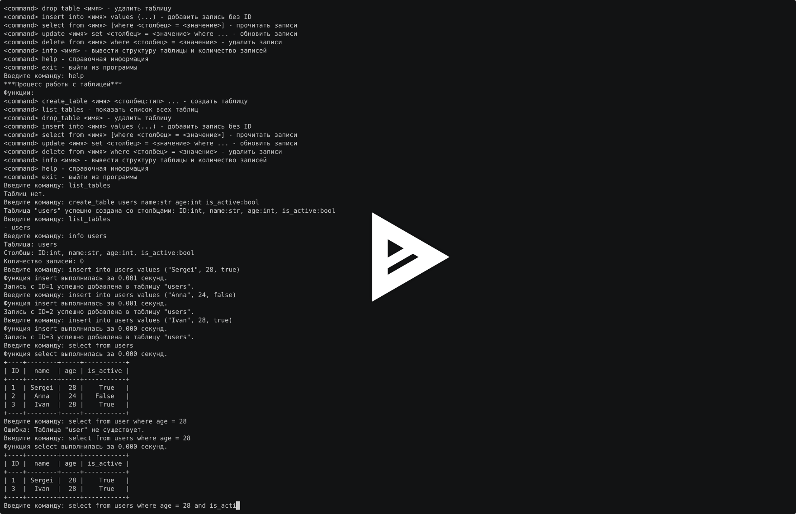

# Примитивная база данных

Вторая домашняя работа по Python: консольная база данных с JSON-хранилищем.
Пакет `primitive_db` поддерживает таблицы с типизированными столбцами,
CRUD-команды, подтверждение удаления и кэширование выборок.

## Установка и запуск

Нужны Python 3.12 или новее и [uv](https://docs.astral.sh/uv/getting-started/installation/).

```sh
git clone https://github.com/andreidelhi/python-dz2.git
cd python-dz2
make install
make run
```

Эквивалентные команды без Make:

```sh
uv sync --locked
uv run database
```

Команда `uv run project` запускает то же приложение. Из установленного пакета
доступны команды `database` и `project`.

## Управление таблицами

| Команда | Назначение |
| --- | --- |
| `create_table users name:str age:int is_active:bool` | Создать таблицу |
| `list_tables` | Показать таблицы |
| `info users` | Показать столбцы и количество записей |
| `drop_table users` | Удалить таблицу и её данные |
| `help` | Показать справку |
| `exit` | Выйти |

Пример: создайте таблицу командой `create_table users name:str age:int is_active:bool`,
проверьте структуру через `info users` и список через `list_tables`.
Удалить её можно командой `drop_table users`, подтвердив действие ответом `y`.

## CRUD-операции

| Команда | Назначение |
| --- | --- |
| `insert into users values ("Sergei", 28, true)` | Добавить запись |
| `select from users` | Показать все записи |
| `select from users where age = 28` | Выбрать записи по условию |
| `update users set age = 29 where name = "Sergei"` | Обновить записи |
| `delete from users where ID = 1` | Удалить подходящие записи |

### Типы и условия

- `int`: целое число, например `28` или `-5`.
- `str`: строка в одинарных или двойных кавычках, например `"Сергей Иванов"`.
- `bool`: `true` или `false`, без кавычек. Числа `0` и `1` не заменяют bool.

Имена таблиц и столбцов — идентификаторы без пробелов и кавычек.
Столбец `ID:int` добавляется первым автоматически. В `insert` передаются
только значения остальных столбцов в порядке схемы. Новый ID равен максимальному
ID среди существующих записей плюс один; для пустой таблицы это `1`.
Изменять ID командой `update` нельзя.

Условия поддерживают равенство; несколько условий соединяются `and`.
В `set` несколько присваиваний разделяются запятыми:

```text
update users set age = 30, is_active = false where name = "Sergei" and age = 29
```

Команды и служебные слова нечувствительны к регистру, имена чувствительны.
Для `update` и `delete` условие `where` обязательно. Строковые литералы
сохраняют пробелы, запятые и скобки. В двойных кавычках работают JSON-экранирования,
например `"Анна \"А\""` и `"C:\\data"`.

Перед удалением таблицы или записей приложение запрашивает подтверждение.
Только ответ `y` выполняет операцию, любой другой ответ отменяет её.
Неверная команда, отсутствующая таблица или ошибка типа выводятся в консоль;
после ошибки можно ввести следующую команду. `Ctrl+D` и `Ctrl+C` завершают сеанс.

## Пример сеанса

```text
create_table users name:str age:int is_active:bool
insert into users values ("Sergei", 28, true)
insert into users values ("Anna", 24, false)
select from users
update users set age = 29 where name = "Sergei"
select from users where age = 29
info users
delete from users where ID = 1
y
drop_table users
y
exit
```

Результат первой выборки:

```text
+----+--------+-----+-----------+
| ID |  name  | age | is_active |
+----+--------+-----+-----------+
| 1  | Sergei |  28 |    True   |
| 2  |  Anna  |  24 |   False   |
+----+--------+-----+-----------+
```

## Демонстрация работы

Ручная демонстрация: установка зависимостей, создание таблицы, вставка и
фильтрация записей, обновление, обработка ошибок, отмена удаления, перезапуск
с сохранёнными данными и удаление таблицы.

[](https://asciinema.org/a/yKrcrkxUEtoUTKBn)

[Посмотреть запись в asciinema](https://asciinema.org/a/yKrcrkxUEtoUTKBn).
Исходная [терминальная запись](docs/demo.cast) также сохранена в репозитории.
Из неё убраны предшествующие пробные сеансы; время между командами
и их вывод сохранены.

```sh
uvx --from asciinema asciinema play docs/demo.cast
```

## Хранение и архитектура

База создаётся в **текущей рабочей директории**. Схемы лежат в `db_meta.json`,
записи — в `data/<имя_таблицы>.json`. Они сохраняются после каждой успешной
изменяющей команды и доступны после перезапуска. Отсутствующие JSON-файлы
читаются как пустые структуры; повреждённый JSON выдаёт ошибку.
Файлы базы исключены из Git. Приложение рассчитано на один процесс.
Создание таблицы не перезаписывает уже существующий файл данных. При ошибке
записи метаданных новый пустой файл удаляется. Удаление таблицы сначала сохраняет
метаданные; если удалить файл данных не удалось, прежние метаданные восстанавливаются.

```text
src/primitive_db/
├── __init__.py
├── main.py          # точки входа database и project
├── engine.py        # цикл команд и вывод PrettyTable
├── core.py          # схемы, проверка типов и CRUD
├── utils.py         # чтение и сохранение JSON
├── parser.py        # разбор команд с shlex
├── decorators.py    # обработка ошибок, подтверждение, таймер, кэш
└── constants.py     # пути, типы и справка
tests/              # регрессионные и консольные тесты
```

Приложение реализовано функциями. Из стандартной библиотеки оно использует
`json`, `shlex`, `time` и `os`; внешние зависимости — `prompt` и `prettytable`.

`handle_db_errors` обрабатывает ошибки в одном месте. Фабрика декораторов
`confirm_action` защищает `drop_table` и `delete`. Декоратор `log_time` замеряет
`insert` и `select` через `time.monotonic()` и выводит время с тремя знаками
после запятой.

`create_cacher()` возвращает функцию с замыканием. Выборка кэшируется по данным
таблицы и условию: изменение записей меняет ключ, поэтому старый результат
не используется. Повторный запрос экономит фильтрацию, но всё ещё читает JSON
и формирует ключ. Кэш ограничен 128 результатами; наружу возвращаются копии строк.

## Проверки и сборка

```sh
make lint
make test
uv run ruff format --check .
make build
uvx twine check dist/*
```

`make check` запускает линтер, тесты и сборку. В GitHub Actions те же проверки
выполняются на Python 3.12. Тесты используют временные директории и проверяют
парсер, CRUD, типы, JSON, кэш, подтверждения и запуск отдельными процессами.
Тестовое окружение не меняет пользовательскую базу.

Сборка создаёт wheel и исходный архив в `dist/`. Для установки wheel в отдельное
окружение можно выполнить `uv pip install dist/primitive_db-0.1.0-py3-none-any.whl`.
